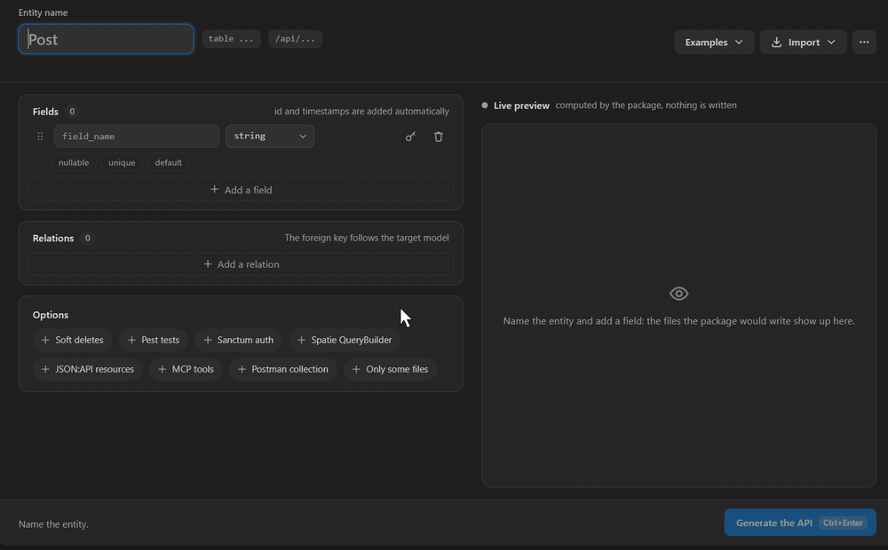
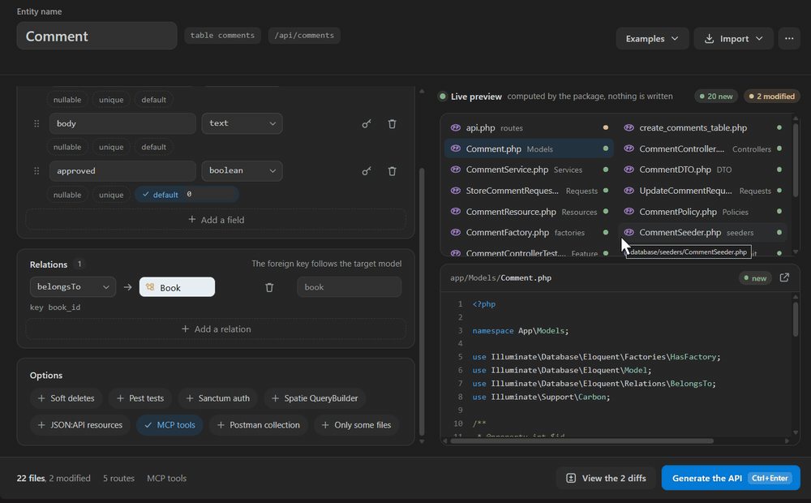
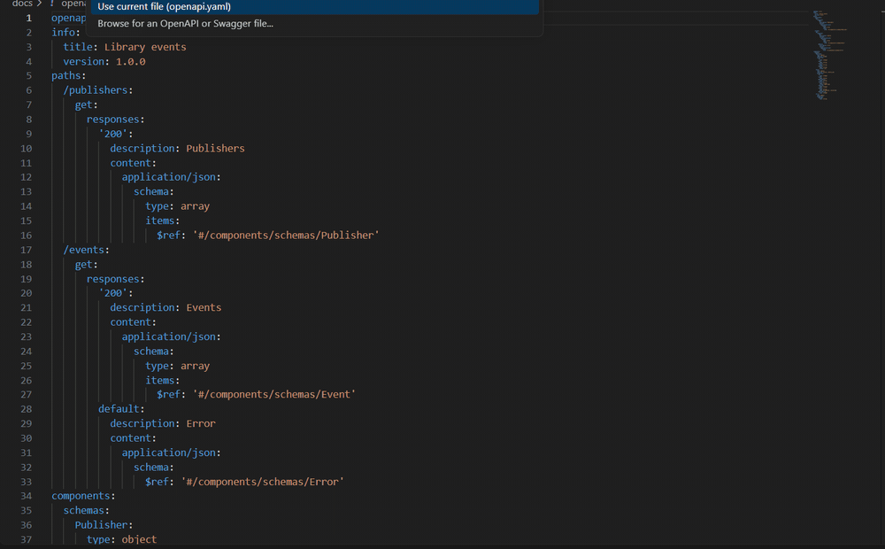
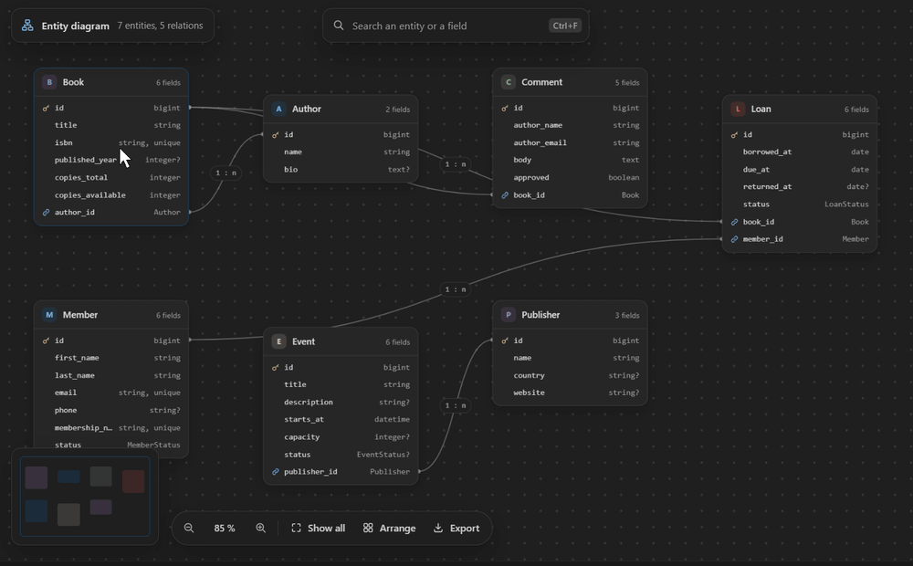
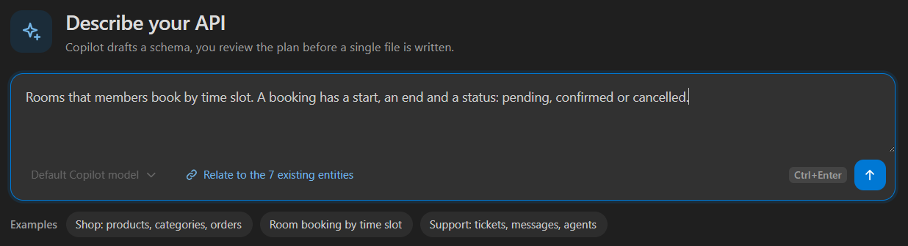
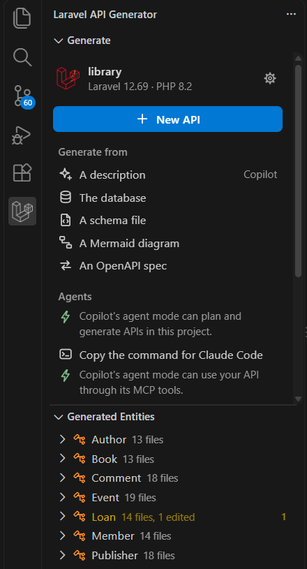

# Laravel API Generator - VS Code Extension

[](https://marketplace.visualstudio.com/items?itemName=Nameless0l.laravel-api-generator)
[](https://open-vsx.org/extension/Nameless0l/laravel-api-generator)
[](LICENSE)

Generate complete REST APIs for Laravel without touching the terminal. Visual interface for the [nameless/laravel-api-generator](https://packagist.org/packages/nameless/laravel-api-generator) package.

> **13 production-ready files per entity** -- Model, Controller, Service, DTO, Store and Update requests, Resource, Policy, Migration, Factory, Seeder, Feature Test, Unit Test -- plus route & seeder registration. All in one click.

---

## Demo

[](https://youtu.be/bRK9Y8jn7yY)

*Two minutes, recorded for real: the MCP server for AI agents, the generated code, then the extension 1.1.*

### Build an entity, the preview follows



*The files on the right come from the package installed in your project, rendered as you edit the form.*

### One click, then the next steps in place



*The API ready screen runs the migrations, the tests, the seeding and the API docs, each with its result.*

### Review before anything is written



*A description, the database, a schema file, a Mermaid diagram or an OpenAPI spec: every source opens the package's dry run first.*

### The entity diagram



---

## Features

### Visual Entity Builder

Create API entities through a form instead of CLI flags:

- **Entity name** input with PascalCase validation and reserved name detection
- **Examples menu**: fills the form with a blog post, a product, a task, a comment, a profile or an article
- **Nullable, unique and default** on each field, sent to the package in the schema file format (package >= 3.9)
- **Reorder fields** -- drag a field by its handle, or press Alt+Up / Alt+Down on its row; the live preview follows
- **Dynamic fields** -- add/remove fields with name and type selector (string, integer, text, float, boolean, json, date, datetime, uuid, etc.)
- **Relations section** -- add `belongsTo` / `hasMany` / `hasOne` / `belongsToMany` relations directly in the UI; generation hands the form to the package in the schema file format, so you get full FK support, foreign-keyed factories and tests
- **Options toggles** -- Auth (Sanctum), Postman collection export, Soft Deletes, Spatie QueryBuilder, Pest tests
- **Enum fields** -- pick the `enum` type, type the values (`draft,published`) and get a backed PHP enum class, model cast, `Rule::enum()` validation and factory fake (package >= 3.6)
- **Primary key designation** -- check `PK` on a field to replace the default `id`; the model, migration and every incoming relation follow (package >= 3.6)
- **Model autocomplete** -- relation targets suggest the models already in `app/Models`
- **Inline validation** -- each invalid row says what is wrong under it, and the footer says what still blocks **Generate the API**
- **Your form is kept** -- the draft is saved per project and comes back when you reopen the builder or VS Code; an example or an import applied over a filled form offers **Undo**
- **Stop a running generation** -- while the API is generated the main button is locked, so a double click cannot start it twice, and a **Stop** button ends the artisan process; a stopped generation says so in a neutral notice, not as a failure
- **File preview** -- see what files will be generated before running, with the package's warnings
- **Sail and Docker** -- point `laravelApiGenerator.phpCommand` at `["./vendor/bin/sail", "php"]` or `["docker", "compose", "exec", "-T", "app", "php"]` and every action runs inside the container
- **Real-time code preview** -- rendered by the package installed in your project, so it is exactly the code that will be written: every generated file, routes and seeder included, your published stubs, badges for new, modified and unchanged files, and a diff for modified ones
- **Agent skill** -- in Laravel projects, GitHub Copilot (VS Code 1.109+) and Cursor get the package's `laravel-api-generator` skill, so they generate APIs with `make:fullapi` instead of writing the files by hand
- **MCP server for agents** -- with package 3.12 or later and `laravel/mcp` in the project, Copilot's agent mode (VS Code 1.101+) lists a Laravel API Generator server, and Cursor gets the same server with no `mcp.json` to write: the agent lists your entities, previews a generation, then generates the API or adds fields itself, and never overwrites a file you edited. It runs with your PHP command, Sail and Docker included. The sidebar's **Agents** block installs `laravel/mcp` when it is missing, and copies the command that adds the server to Claude Code
- **MCP tools for your API** -- with package 4.2 or later, the **MCP tools** option of the builder and of the review screen writes one tool per action for each entity and a server for your application. Copilot's agent mode and Cursor then list `<folder> API` on their own, and the **Agents** block copies the command for Claude Code: the agent lists, reads, creates, updates and deletes records through the services, validation rules and policies of the REST API
- **Schema file autocompletion** -- `api-schema.yaml`, `.yml` and `.json` are checked against the package's JSON Schema: completion for keys and types, typos flagged before you generate (YAML needs the Red Hat YAML extension)
- **Your edits are safe** -- with package 3.11 or later, regenerating keeps the files you edited by hand; a modal names them and lets you overwrite them or keep your changes (older packages: a modal lists every file that will be overwritten)
- **Auto-open generated files** -- after a successful generation, the new Model and Controller open in the editor

### Generate APIs from Database (one shot)

The killer feature for legacy projects (requires package >= 3.5): generate complete REST APIs for **every table at once**, straight from the existing schema.

- Run **Laravel API Generator: Generate APIs from Database** (command palette or sidebar `...` menu)
- Multi-select the tables (all preselected; `users` is unchecked so `app/Models/User.php` is never overwritten)
- Pick options: Spatie QueryBuilder filtering, and whether to also generate migration files
- Foreign keys become `belongsTo`/`hasMany`, pivot tables become `belongsToMany`, `deleted_at` enables Soft Deletes: all automatically

### Generate from a Schema File (api-schema.yaml)

Describe the whole API in a declarative, versionable YAML/JSON file and regenerate everything in one command (requires package >= 3.5):

- Run **Laravel API Generator: Generate APIs from Schema File**
- The extension auto-detects `api-schema.yaml` / `.yml` / `.json` at the project root, or lets you browse for one
- Entities are generated parents-first with foreign-key-safe migration ordering and automatic pivot migrations

### Generate from a Mermaid Diagram

Paste a Mermaid `erDiagram` or `classDiagram` (hand-written or produced by an AI assistant) and turn it into a working API (requires package >= 3.5):

- Run **Laravel API Generator: Generate APIs from Mermaid Diagram**
- Uses the active `.mmd` file, or lets you browse for one
- Cardinalities (`||--o{`, `"1" --> "*"`) become the right Eloquent relations on both sides

### Import from Existing Database (single table, form pre-fill)

Prefer to review one table before generating?

- Open the builder's **Import** menu and pick **A database table**
- The extension lists every user table (system tables like `migrations`, `sessions`, `personal_access_tokens` are filtered out)
- Pick a table; columns are read and mapped to the generator's vocabulary (`string`, `integer`, `boolean`, `json`, ...)
- The form is auto-filled with the entity name (singularized + PascalCased), the field list, and the Soft Deletes flag (when `deleted_at` is present)
- Review and click **Generate API**

### Describe an API

Start from a sentence: *a library that lends books to members, a loan has a due date*.



- Open **A description** in the sidebar, or run **Describe an API**, and write your API or start from an example
- Pick the chat model (GitHub Copilot first, VS Code 1.90+); it drafts an `api-schema.yaml` that relates to the entities your project already has. The model list follows Copilot as it loads. In Cursor and the other forks without chat models, the entry stays hidden: their agent reaches the same generator through MCP
- The proposed entities show up as cards; click one to adjust it in the YAML draft, the cards follow your edits
- **Adjust** sends the proposal back to the model with what to change (*add a status to orders, drop the tags*) and replaces it; **Propose something else** starts over from your description
- Your description, the model and the last proposal are kept per project: closing the panel or reloading the window loses nothing
- **Review the plan** runs the package's dry run: entities, files to create or update, options, then **Generate**. **Save as api-schema.yaml** keeps the draft as the source of your API
- When the model cannot answer, the panel says why and offers the provider's own fix, such as setting its API key

### Generate from an OpenAPI Spec

Hand an OpenAPI 3.0, 3.1 or Swagger 2.0 spec, JSON or YAML, to the package from the command palette, the sidebar or the builder's **Import** menu:

- A dry run first names the entities, counts the files to create and update, and lists the schemas left aside (`NewPet`, `ErrorResponse`...) with the reason
- References become `belongsTo`, lists of references `hasMany` or `belongsToMany`, `postId` next to a `Post` schema a relation, string enums PHP enums, `deletedAt` soft deletes
- A spec outside the project goes through stdin, so Sail and Docker work too
- With a package older than 3.13, the button keeps the previous JSON-only importer

### JSON Bulk Import

Import a `class_data.json` file to generate multiple entities at once:

- Visual preview of all entities with their fields and relationships
- **Continue** opens the review screen with the files of every entity. Nothing is written before **Generate**, `class_data.json` included
- A class that extends another, or a package too old for the dry run, still goes through `class_data.json`: a modal asks before the file is written
- Supports relationships (oneToMany, manyToOne, manyToMany, compositions, aggregations)
- [Download a sample class_data.json](https://github.com/Nameless0l/laravel-api-generator/blob/main/examples/class_data.json) to try it out (Blog with Author, Category, Article, Tag)

### Edit an Existing Entity

Day-30 problem solved: evolve a generated API without wiping your manual changes (package >= 3.6).

- Click **Edit Entity** on an entity in the sidebar tree (on hover or by right-click), or run **Edit Entity...** or **Add Fields to Entity...** from the command palette and pick the entity in the list
- The builder opens on the entity. Its fields and relations are shown locked: they come from the definition the package recorded (4.1+), or are read back from its migrations and model
- Add the new fields as rows, then **Review the changes**: the review screen runs the `--add-fields` dry run and shows the incremental migration and every patched file with its diff
- **Generate** applies it: an incremental `Schema::table()` migration, and the fillable columns, the casts, the model PHPDoc, the validation rules, the factory and the resource patched in place
- The API ready screen then runs the migration and shows its result

### Delete an API, after a review

- Click **Delete** on an entity in the sidebar tree, or run **Delete API...** from the command palette and pick the entity in the list (each one with its file count and its edited files)
- The review screen lists what the package's dry run would remove, calls out the files you edited by hand, and names the entries that leave `routes/api.php` and `DatabaseSeeder.php`. Nothing is deleted before the red **Delete** button
- With a package too old for the dry run, the confirmation modal is kept

### Regenerate Single File(s)

Want a fresh resource or fresh tests without retyping the schema?

- Hover an entity in the sidebar tree and click **Regenerate File(s)**, use **Regenerate** in the diagram inspector, or run the command from the palette and pick the entity in the list
- Multi-select the artifacts to rebuild (Model, Controller, Service, DTO, Requests, Resource, Factory, Seeder, Policy, Feature Test, Unit Test)
- The review screen shows the diff of every file before anything is written, and keeps the files you edited by hand unless you choose to overwrite them
- With package 4.1 or later, the entity comes back from the definition the package recorded when it generated it: relations, enum values, foreign keys, unique and nullable columns and options included. An entity generated before 4.1 is read back from its migrations, its model and its enums
- The underlying call is `make:fullapi --only=Type,Type`, so the migration, the API route and the seeder registration are left untouched

### Sidebar Entity Explorer

The activity bar view opens on a **home panel**: the project with its Laravel and PHP versions and the package state (with the Composer command that fixes it when needed), a **New API** button, the sources to generate from (a description, the database, a schema file, a Mermaid diagram, an OpenAPI spec) and the project tools (entity diagram, migrations and tests, snippets, documentation). While the package is missing, the main button installs it and the sources wait for it. Outside a Laravel project, the panel says so and offers to open a folder or read the documentation. Right below, the entity tree tracks everything the generator created:



- Each entity expands into three groups: **Files**, **Fields**, **Relations**
- **Files** list what the package recorded in `.api-generator/manifest.json` (Store and Update requests, enums and `--add-fields` migrations included), with a green check / red slash each and a click to open
- **Fields** are read from the model's `$fillable`, or its `#[Fillable]` attribute on Laravel 13
- **Relations** are extracted from the model's `belongsTo` / `hasMany` / `hasOne` / `belongsToMany` methods, with a `belongsTo -> Author` style description
- Files you edited by hand since the generation are flagged, and the entity shows how many (package >= 3.11)
- Actions on each entity, on hover and in its context menu: **Edit Entity**, **Regenerate File(s)** and **Delete**
- An empty tree says why and offers the next step: install the package, or create the first API

Right-click an `api-schema.yaml` / `.json`, a `.mmd` file or an OpenAPI / Swagger spec in the Explorer, or its editor tab, to generate from it.

### Entity Diagram (infinite canvas)

Visualize every generated entity and its relationships on an Obsidian-style canvas:

- Infinite dotted grid that follows pan and zoom, with a hand cursor to drag the view
- Scroll pans, Shift+scroll pans horizontally, Ctrl+wheel (or a trackpad pinch) zooms toward the cursor
- Each card lists the columns with their type, read from the migrations, foreign keys included
- Inverse declarations are merged into one link with cardinality pills; cards stay draggable at any zoom
- Search an entity or a field (Ctrl+F, Cmd+F on macOS), a minimap, **Show all** (F), **Arrange** with **Undo**, and an export to SVG or Mermaid
- The arrow keys pan the view, Shift makes the steps longer
- Select a card to inspect its fields, relations and files (up to date, edited or missing), then add fields, regenerate, open the model or delete the API

### API Ready and Project actions

After a generation, the panel shows the files written and the routes registered, then runs the next steps in place, each with its own progress and result:

| Step | What it runs |
|------|--------------|
| **Run the migrations** | `php artisan migrate`, after offering to create `.env` from `.env.example` when it is missing |
| **Run the tests** | `php artisan test`, with a Stop button |
| **Fill the database** | `php artisan migrate:fresh --seed`, after a second click to confirm |
| **Open the API documentation** | Finds or starts the dev server, then opens the Scramble docs; offers to install Scramble when missing |
| **Customize the generated code** | Publishes the package's stubs, then opens their folder |

**Project actions**, in the sidebar and the entities view menu, opens the same steps at any time with the API routes of the project.

### Stub Validation Guard

When you customize stubs (`stubs/vendor/laravel-api-generator/...`), the extension calls `api-generator:validate-stubs` before each generation. If a customized stub is missing a required `{{placeholder}}`, you get a modal listing the offending stubs and three actions: **Open Stubs Folder**, **Generate Anyway**, or close.

### Smart Dependency Detection

The extension never lets a missing package silently break the flow:

- The package `nameless/laravel-api-generator` is missing -> the sidebar, the entities view and the walkthrough offer **Install the package** (also in the palette as **Install the Composer Package**), with the 3.15 line on Laravel 10 and 11; the builder says what it waits for instead of failing on Generate
- Open the API documentation without `dedoc/scramble` -> the step offers to install it
- Check the **Auth (Sanctum)** option without `laravel/sanctum` -> prompted to install or generate without auth

### Smart Server Management

The API documentation step handles the development server:

1. Scans common ports (8000-8003, 8080) to find a running server
2. If none found, starts `php artisan serve` automatically
3. Detects the actual port and opens the correct URL
4. Server process stops when the panel is closed

### French / English UI (i18n)

The whole UI -- command titles, views, the walkthrough, settings, panel labels, popups, QuickPick prompts, error messages -- is available in **English and French**. Language follows VS Code's display language by default; can be forced via the `laravelApiGenerator.locale` setting (`auto` / `en` / `fr`).

---

## Quick Start

### 1. Install the package

```bash
composer require --dev nameless/laravel-api-generator
```

It is a **dev dependency with zero lock-in**: nothing from the generator ships to production, and the generated code does not depend on it; you can even remove the package once your API is generated.

### 2. Install the extension

Search **"Laravel API Generator"** in VS Code Extensions (`Ctrl+Shift+X`), or install from [Marketplace](https://marketplace.visualstudio.com/items?itemName=Nameless0l.laravel-api-generator). In Cursor and the other VS Code forks, install it from [Open VSX](https://open-vsx.org/extension/Nameless0l/laravel-api-generator).

### 3. Generate your first API

1. Open your Laravel project in VS Code
2. Click the **Laravel API Generator** icon in the activity bar
3. Click **New API**, then pick an example, import from your database, an OpenAPI spec or a JSON file, or fill the form
4. Click **Generate the API**

### 4. Customize the generated code

Want a different controller layout, different test asserts, more fields in the resource? Run **Customize the generated code** from Project actions (or **Customize the stubs** in the builder's menu), edit the files in `stubs/vendor/laravel-api-generator/`, and regenerate. Your stubs are validated before every generation.

---

## What Gets Generated

```
app/Models/Product.php                          -- Eloquent model with fillable, casts(), relationships
app/Http/Controllers/ProductController.php      -- CRUD controller with route model binding and policy checks
app/Services/ProductService.php                 -- Paginated, filtered and sorted index
app/DTO/ProductDTO.php                          -- Data transfer object that keeps PATCH partial
app/Http/Requests/StoreProductRequest.php       -- Validation for creation
app/Http/Requests/UpdateProductRequest.php      -- Validation for partial updates
app/Http/Resources/ProductResource.php          -- API resource transformer
app/Policies/ProductPolicy.php                  -- Authorization policy
database/migrations/xxxx_create_products_table.php
database/factories/ProductFactory.php           -- Faker-based factory
database/seeders/ProductSeeder.php              -- Seeds 10 records
tests/Feature/ProductControllerTest.php         -- Full CRUD endpoint tests (with actingAs when --auth)
tests/Unit/ProductServiceTest.php               -- Service layer tests
routes/api.php                                  -- Route::apiResource auto-registered
database/seeders/DatabaseSeeder.php             -- Seeder auto-registered
```

---

## Requirements

- **VS Code** 1.82+
- **PHP** 8.2+ on your PATH, Herd's `php.bat` on Windows included (or configure `laravelApiGenerator.phpPath`, or `laravelApiGenerator.phpCommand` for Sail and Docker)
- A **Laravel 10 to 13** project
- The package: `composer require --dev nameless/laravel-api-generator`. Its 4.x line needs Laravel 12, so Laravel 10 and 11 projects use the 3.x line, which the extension installs for them.

---

## Extension Settings

| Setting | Default | Description |
|---------|---------|-------------|
| `laravelApiGenerator.phpPath` | `php` | Path to the PHP executable |
| `laravelApiGenerator.phpCommand` | `[]` | Full command that runs PHP, one argument per item (Sail, Docker). Wins over `phpPath` when set. |
| `laravelApiGenerator.mcp.enabled` | `true` | Offer the package's MCP server to Copilot's agent mode and to Cursor (needs `laravel/mcp` and package 3.12+) |
| `laravelApiGenerator.mcp.apiServer` | `true` | Offer the MCP server of your generated API to Copilot's agent mode and to Cursor, once `make:fullapi --mcp` has written it (package 4.2+) |
| `laravelApiGenerator.locale` | `auto` | UI language: `auto` (follow VS Code), `en`, or `fr` |

---

## Related

- [nameless/laravel-api-generator](https://github.com/Nameless0l/laravel-api-generator) -- The Laravel package (Packagist)
- [Sample class_data.json](https://github.com/Nameless0l/laravel-api-generator/blob/main/examples/class_data.json) -- Example Blog schema to test with
- [Scramble](https://github.com/dedoc/scramble) -- Auto-generated API documentation (Swagger)

---

## Contributing

1. Fork the repo
2. Create a feature branch (`git checkout -b feature/my-feature`)
3. Commit your changes
4. Push and open a Pull Request

---

## Support the project

This extension is free and MIT-licensed, and will stay that way. If it saves you time, you can support its development through [GitHub Sponsors](https://github.com/sponsors/Nameless0l) or [Buy Me a Coffee](https://buymeacoffee.com/loicmbassi).

---

## License

MIT
